# WBC MultiStream CNN

**A three-stream CNN with gated feature fusion that classifies white-blood-cell images using raw, optical-density and anisotropic-diffusion views.**

[](https://github.com/RashiChauhan67/wbc-multistream-cnn/actions/workflows/ci.yml)
[](LICENSE)


[Overview](#overview) · [Architecture](#architecture) · [Preprocessing](#preprocessing) · [Quick start](#quick-start) · [Dataset](#dataset) · [Results](#results) · [Notes](#notes)

## Overview

Each microscope image of a blood cell is turned into three views: the **raw** image, its **optical density** (a stain-independent colour space), and an **anisotropic-diffusion** smoothing of the optical density. Each view goes through its own small CNN. The three 128-d feature vectors are concatenated, re-weighted by a sigmoid gate, and classified by a small MLP.

This repository has a cleaned, tested Keras 3 implementation, the original experiment notebook, and the recorded results.

| | |
|---|---|
| Classes | basophil, erythroblast, monocyte, myeloblast, segmented neutrophil |
| Images | 5,000 (1,000 per class), 128 x 128 |
| Split | 80% / 20%, stratified (4,000 train / 1,000 test) |
| Parameters | 451,333 (1.72 MB) |
| Test accuracy | **97.90%** (final-epoch weights, 1,000 test images) |
| Cost | about 1.16 GFLOPs per image (hand estimate) |

The accuracy is the value recorded in the notebook.

## Architecture

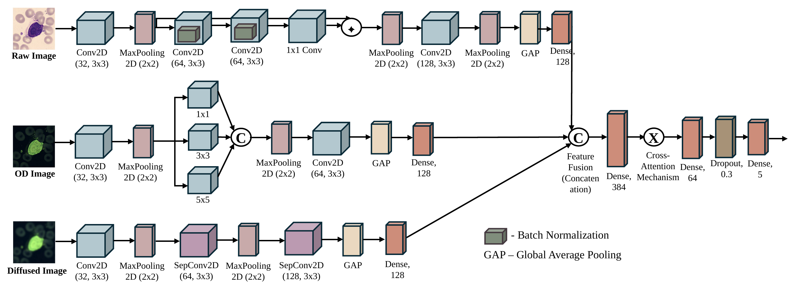

## Preprocessing

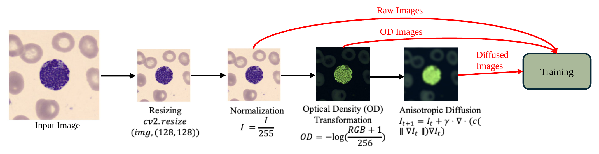

Raw image, optical density and anisotropic diffusion for one cell:

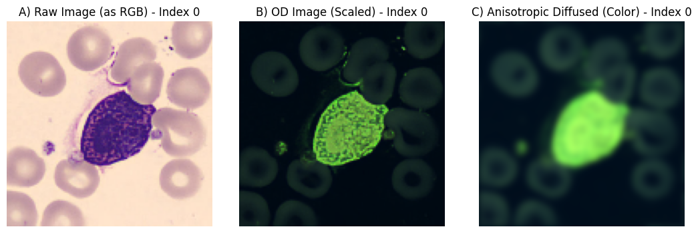

## Quick start

```bash
git clone https://github.com/RashiChauhan67/wbc-multistream-cnn.git
cd wbc-multistream-cnn
python -m venv .venv && source .venv/bin/activate
pip install -e .
```

Train and evaluate:

```bash
# Original protocol (single train/test split)
python scripts/train.py --data-dir /path/to/blood-cell-images --output-dir runs/notebook --ablation

# Holdout protocol: validation comes from the training data, with early stopping
python scripts/train.py --data-dir /path/to/blood-cell-images --protocol holdout \
    --output-dir runs/holdout

# Evaluate a saved model on the regenerated test split
python scripts/evaluate.py --data-dir /path/to/blood-cell-images \
    --model runs/holdout/model.keras --ablation
```

Defaults: Adam (1e-4), batch size 32, 50 epochs, split seed 42. Building the optical-density and diffusion views for 5,000 images took about 30 seconds in a timing run on a laptop CPU. Each run writes `model.keras`, `history.json` and `metrics.json`.

Use the model and preprocessing directly:

```python
from wbc_multistream import build_model, build_views, compile_model

raw, od, diffused = build_views(images_bgr)  # uint8 BGR batch -> three float32 views
model = compile_model(build_model())  # 451,333 parameters
probabilities = model.predict([raw, od, diffused])
```

## Dataset

The notebook used the Kaggle dataset `blood-cell-images-for-cancer-detection`: 5,000 images, 1,000 per class, in five folders (`basophil`, `erythroblast`, `monocyte`, `myeloblast`, `seg_neutrophil`). Data is not included; see [`data/README.md`](data/README.md). Images are read with OpenCV and resized to 128 x 128.

## Results

Results from the original experiment notebook. More detail is in [`results/recorded_results.md`](results/recorded_results.md).

Test accuracy **0.9790**, test loss 0.0660, on 1,000 images (200 per class). Per-class values are computed from the confusion matrix.

| Class | Precision | Recall | F1 |
|---|---|---|---|
| basophil | 0.965 | 0.970 | 0.968 |
| erythroblast | 0.956 | 0.985 | 0.970 |
| monocyte | 0.979 | 0.950 | 0.965 |
| myeloblast | 1.000 | 0.995 | 0.998 |
| seg_neutrophil | 0.995 | 0.995 | 0.995 |
| macro avg | 0.979 | 0.979 | 0.979 |

| Confusion matrix (counts) | Confusion matrix (normalized) |
|---|---|
|  | 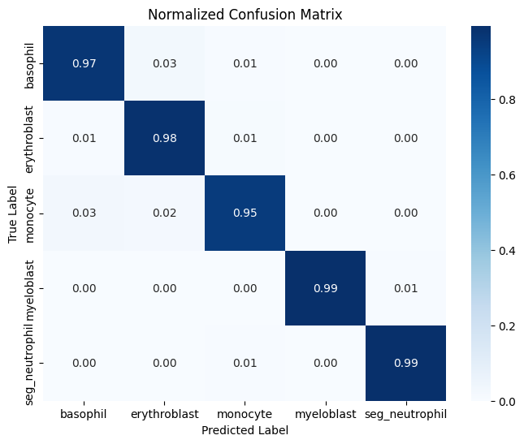 |

| ROC curves | Training curves |
|---|---|
| 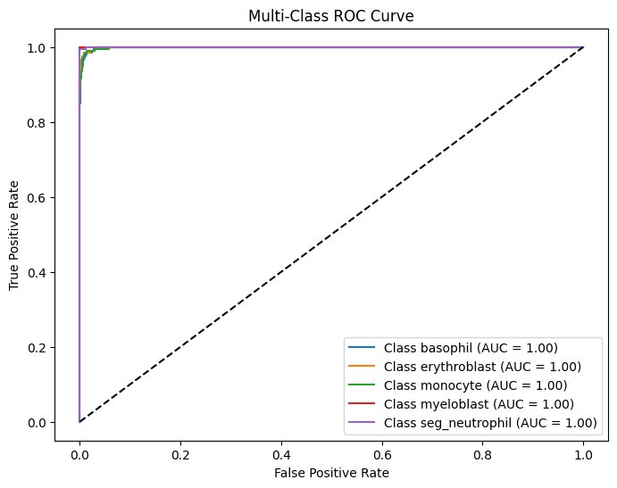 | 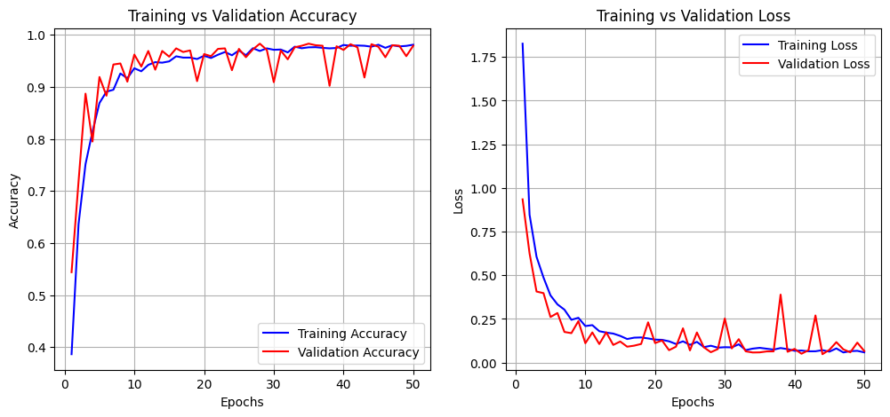 |

Feature space before and after training (t-SNE):

| Before training | After training |
|---|---|
| 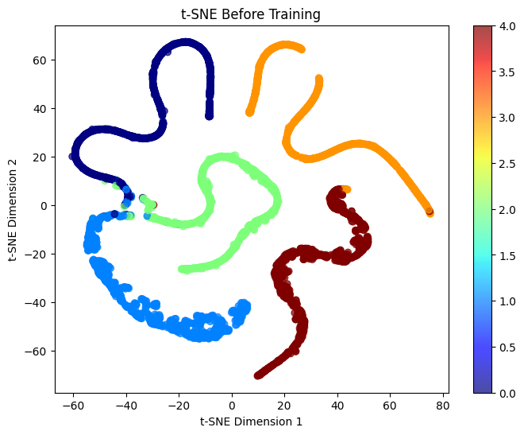 | 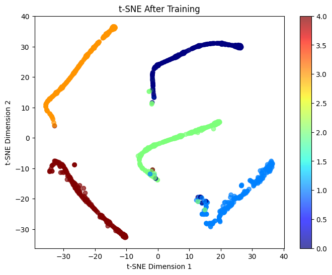 |

**Input ablation.** Accuracy when an input is replaced by zeros at inference time, with no retraining:

| Inputs | Accuracy |
|---|---|
| all three | 0.9790 |
| without optical density | 0.5640 |
| without diffused | 0.9790 |
| raw only | 0.5630 |

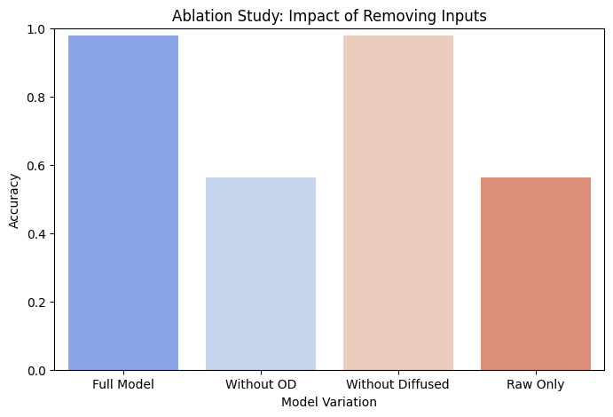

Explanations from the notebook:

| Grad-CAM | LIME |
|---|---|
| 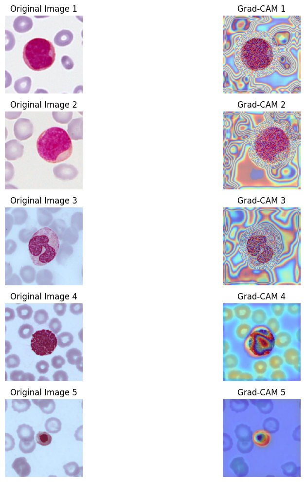 | 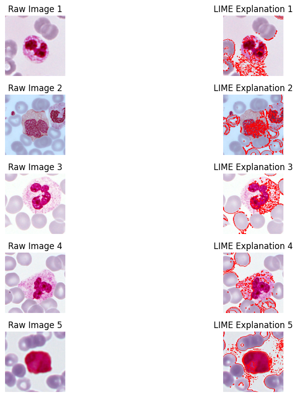 |

## Notes

- The model has 451,333 parameters (451,077 trainable), matching the notebook's `model.summary()`; the tests check them.
- The raw stream receives unscaled 0 to 255 pixel values (BGR, as read by OpenCV); the optical-density and diffused views are on their own scales.
- The gate is a sigmoid feature re-weighting of the concatenated features (a `Dense` layer and an element-wise multiply).
- The colour-stain and red-cell shape augmentations in `preprocessing.py` are available for optional use.
- `--protocol holdout` trains with a validation set taken from the training data, with early stopping, and uses the test set once.

## Repository structure

```
.
├── src/wbc_multistream/ # model, preprocessing, data, training, evaluation
├── scripts/             # train.py, evaluate.py
├── tests/               # unit tests (synthetic data; no dataset needed)
├── notebooks/           # original experiment notebook
├── docs/figures/        # architecture, preprocessing and example figures
├── results/             # recorded notebook results and figures
└── data/README.md       # dataset instructions
```

Development: `pip install -e ".[dev]"`, then `ruff check .` and `pytest`.

## License

MIT. See [LICENSE](LICENSE). The dataset has its own license; check it before reuse.
